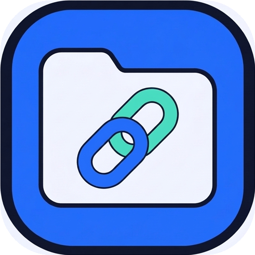
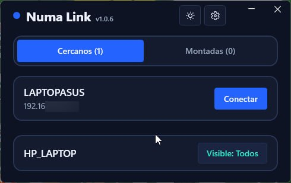
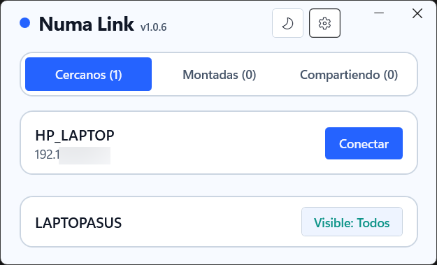
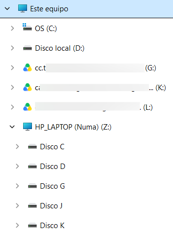
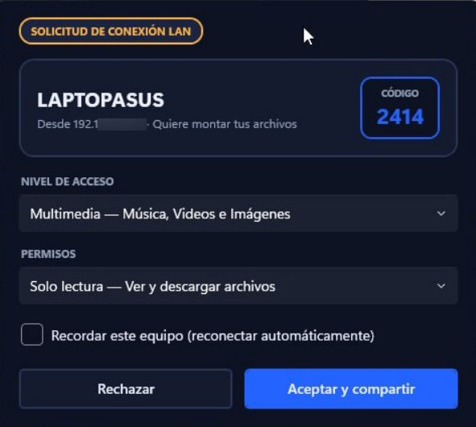
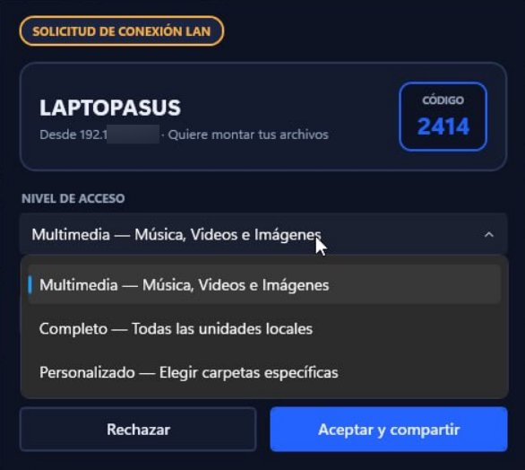
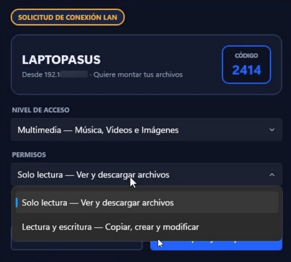
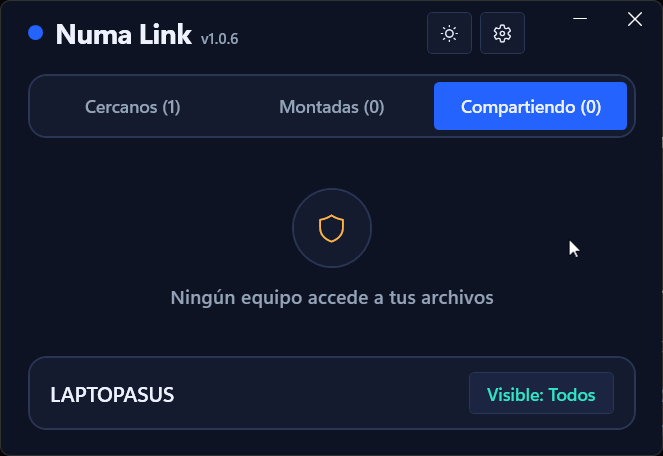
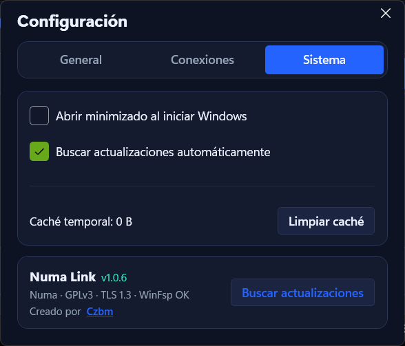

<div align="center">



# NUMA Link

**Agente ligero en segundo plano para Windows que conecta equipos en la misma red local con la simplicidad de Quick Share y monta sus carpetas como unidades reales (`Z:\`) cifradas con TLS.**

-2563eb?style=flat)


<br />


<br />

[¿Qué es?](#qué-es-numa-link) •
[¿Para qué fue pensado?](#para-qué-fue-pensado) •
[¿Cómo funciona?](#qué-hace-y-cómo-funciona) •
[Estilos y temas](#estilos-visuales-temas-e-idioma) •
[Seguridad](#seguridad-y-privacidad) •
[Inicio Rápido](#requisitos-e-instalación) •
[Estructura](#estructura-del-proyecto) •
[Licencia](#licencia)

</div>

---

## ¿Qué es NUMA Link?

**NUMA Link** es una aplicación de escritorio de código abierto construida en **C# / .NET 8 (WPF + WinFsp)** que elimina la fricción de compartir archivos en red local en Windows. En lugar de configurar permisos NTFS, contraseñas de usuario, direcciones IP o carpetas compartidas SMB, NUMA Link descubre automáticamente las PCs cercanas en tu red, solicita permiso mediante un diálogo estilo **Quick Share** con código de verificación y monta las carpetas autorizadas como una **unidad nativa de Windows (`Z:\`, `Y:\`)**.

Al montarse como unidad real mediante **WinFsp**, cualquier programa habitual —el Explorador de Windows, AutoCAD, VS Code, VLC, Photoshop o el visor de fotos— puede abrir, copiar o guardar archivos del otro equipo de forma completamente transparente.

<div align="center">
  <table>
    <tr>
      <td align="center"><br /><em>Interfaz principal en Modo Oscuro (Azul Noche)</em></td>
      <td align="center"><br /><em>Interfaz principal en Modo Claro</em></td>
    </tr>
  </table>
</div>

---

## ¿Para qué fue pensado?

- **Trabajo entre laptop y PC de escritorio:** accede al instante a planos, documentos o proyectos de tu otra computadora sin memorias USB ni subir archivos pesados a la nube.
- **Compartir multimedia en casa u oficina:** expone únicamente Música, Videos y Fotos con un clic usando el nivel *Multimedia*.
- **Colaboración puntual y controlada:** comparte una o varias carpetas específicas en modo *Solo lectura* o *Lectura y escritura*, y desconecta la sesión en cualquier momento.
- **Cero configuración manual:** funciona 100% en red local (Wi-Fi o Ethernet), sin cuentas, sin internet y sin servidores externos.

---

## ¿Qué hace y cómo funciona?

### 1. Conexión intuitiva estilo Quick Share

- **Descubrimiento automático (UDP):** cada PC con NUMA Link aparece automáticamente en *Equipos cercanos* según su modo de visibilidad (*Todos*, *Solo confianza* u *Oculto*).
- **Solicitud instantánea:** al pulsar *Conectar*, el equipo destino muestra una ventana emergente con un código visual de verificación para confirmar el equipo; solo basta con aceptar o rechazar (sin escribir contraseñas ni códigos).
- **Montaje automático:** al aceptar, el equipo solicitante monta la siguiente letra disponible (`Z:\`) con ícono de PC (*Este equipo*) e íconos de disco duro para cada unidad remota, y abre directamente el Explorador de Windows.

<div align="center">
  
  <br />
  <em>Equipo remoto montado como unidad real (<code>Z:</code>) en el Explorador de Windows con sus discos disponibles.</em>
</div>

### 2. Tres niveles de acceso y permisos

| Nivel de acceso | Qué expone | Permisos disponibles |
| :--- | :--- | :--- |
| **Multimedia** | Bibliotecas de Música, Videos e Imágenes de Windows | Solo lectura / Lectura y escritura |
| **Completo** | Todas las unidades locales del equipo (`C:\`, `D:\`, etc.) | Solo lectura / Lectura y escritura |
| **Personalizado** | Carpetas específicas elegidas al momento de aceptar | Solo lectura / Lectura y escritura |

<div align="center">
  <table>
    <tr>
      <td align="center"><br /><em>Solicitud de conexión (aceptar o rechazar)</em></td>
      <td align="center"><br /><em>Niveles de acceso</em></td>
      <td align="center"><br /><em>Permisos de sesión</em></td>
    </tr>
  </table>
</div>

---

## Estilos visuales, temas e idioma

Desde el botón de **Configuración** puedes personalizar la interfaz en vivo (todas las preferencias se guardan automáticamente entre sesiones):

- **Quick Share (Pestañas):** ventana compacta con altura dinámica y 3 pestañas segmentadas (*Cercanos* / *Montadas* / *Compartiendo*) más dock inferior fijo.
- **Horizontal (2 columnas):** vista simultánea de equipos cercanos a la izquierda y unidades montadas a la derecha.
- **Bento Grid:** tarjetas modulares estilo Numa con chips rápidos para unidades montadas y cuadrícula de 2 columnas.
- **Modo Claro y Oscuro:** alternancia instantánea en la barra superior (*Numa Claro* y *Numa Azul Noche*).
- **Bilingüe (Español / English):** cambio de idioma en vivo desde Configuración.
- **Segundo plano (System Tray):** al cerrar con `×` queda residente en la bandeja; con *Iniciar con Windows* arranca minimizado (`--minimized`).
- **Control total en vivo:** desde la pestaña *Compartiendo* o el panel minimalista de *Configuración* puedes editar privilegios en caliente, cortar sesiones, revocar confianza, cambiar el alias de tu equipo y limpiar la caché temporal.
- **Preparado para dispositivos móviles (Android / iOS):** el protocolo LAN y el montador WinFsp soportan rutas POSIX (`/`), nombres amigables de carpetas raíz (`RootDisplayNames`) e identificación automática de teléfonos (`DeviceType`) para integrarse con la app compañera móvil.

<div align="center">
  <table>
    <tr>
      <td align="center"><br /><em>Pestaña Compartiendo (control de accesos locales)</em></td>
      <td align="center"><br /><em>Configuración minimalista (General · Conexiones · Sistema)</em></td>
    </tr>
  </table>
</div>

---

## Seguridad y privacidad

- **Cifrado TLS 1.2 / 1.3 punto a punto:** cada dispositivo genera su propio certificado autofirmado persistente; tanto el emparejamiento como los listados y transferencias viajan cifrados.
- **Token por sesión y aislamiento de rutas:** cada petición remota valida el token de sesión en tiempo constante y bloquea cualquier intento de salir de las carpetas autorizadas.
- **Equipos de confianza revocables:** opción de recordar dispositivos para reconexión automática y revocación inmediata desde Configuración.

---

## Requisitos e instalación

### Opción 1 — Ejecutable portable autocontenido (~70 MB, sin instalar .NET)

1. Descarga `NumaLink.exe` desde la sección [**Releases**](https://github.com/Czbm/numa-link/releases).
2. Al abrirlo por primera vez, si falta el driver de unidad virtual, pulsa **Instalar WinFsp (2.2 MB)** (se instala automáticamente una sola vez).
3. Permite el acceso en redes privadas en el Firewall de Windows (UDP `45821` y TCP `45822`).

> **¿Por qué pesa ~70 MB el archivo `NumaLink.exe`?**  
> El ejecutable se distribuye en formato **autocontenido (self-contained)**: incluye en un solo archivo el *runtime completo de .NET 8 Desktop* y todas las librerías de interfaz y red necesarias para ejecutarse con doble clic en cualquier Windows 10/11 sin instalar dependencias previas. Además, incorpora **actualización automática directa dentro de la app** sin necesidad de abrir el navegador y cierra automáticamente instancias previas activas en el System Tray.

### Opción 2 — Compilar desde el código fuente

```powershell
git clone https://github.com/Czbm/numa-link.git
cd numa-link
dotnet build NumaLink.sln
dotnet run --project src\NumaLink.App\NumaLink.App.csproj
```

---

## Estructura del proyecto

```text
NumaLink.sln
├── assets/icons/                # Ícono oficial de NUMA Link
├── src/
│   ├── NumaFiles.Core/          # Contratos (IFileSystemProvider), modelos y perfiles de acceso
│   ├── NumaFiles.LanShare/      # Descubrimiento UDP, servidor/cliente TCP con TLS 1.3 y sesiones
│   ├── NumaFiles.VirtualDrive/  # Montaje virtual WinFsp (Z:\) e instalador automático de WinFsp
│   └── NumaLink.App/            # Agente ligero en System Tray (3 layouts, ES/EN, Claro/Oscuro)
└── installer/
    └── NumaLink.iss             # Script Inno Setup (empaqueta WinFsp + reglas de Firewall)
```

---

## Licencia

Este proyecto utiliza un esquema de licencia dual, consistente con el resto del ecosistema **NUMA**:

- **Código fuente:** licenciado bajo **GNU General Public License v3.0 (GPLv3)**. Consulta [LICENSE](LICENSE) para ver los términos completos.
- **Documentación y recursos visuales (docs, íconos y capturas):** licenciados bajo **Creative Commons Attribution-ShareAlike 4.0 International (CC BY-SA 4.0)**. Consulta [LICENSE-DOCS](LICENSE-DOCS).
- **Componentes de terceros:** utiliza **WinFsp** (GPLv3) para el montaje de unidades virtuales en modo usuario y **WPF-UI** (MIT) para controles modernos de Windows.
